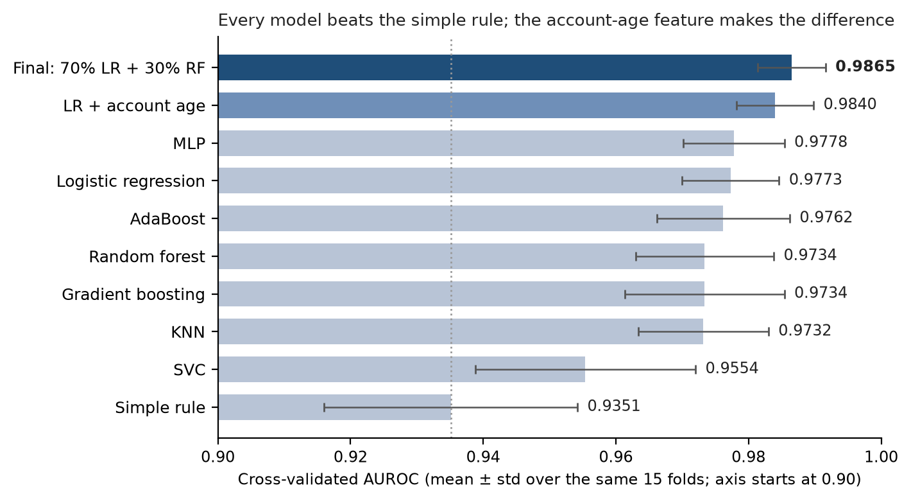

<div align="center">

# Classical Music Meets Classical ML

**Predicting which orchestra patrons will buy a season subscription**

[](https://github.com/albertogomezsoteres/kaggle-classical-music-ml/actions/workflows/ci.yml)


[](LICENSE)

🏆 **Winning solution: first place** in the *Classical Music Meets Classical ML* Kaggle competition<br>
AIPI 520: Modeling Processes and Algorithms · Duke University · Fall 2026 · private leaderboard AUROC **0.989**

</div>

---

## Highlights

- **First place on the final leaderboard** with a deliberately simple model: 70% logistic regression + 30% random forest on 38 engineered features.
- **Every decision made with cross-validation, never with the leaderboard.** Ten models compared on the same 15 folds, fold by fold, so the final model held up on the private leaderboard.
- **One insight made the difference:** the account IDs are sequential, so their order encodes how old each account is. That single feature lifted the cross-validated AUROC from 0.977 to 0.984.
- **Reproducible end to end:** pinned environment, one command to rebuild the submission, and tests that run without the private data.

## Problem

The orchestra has data on its past patrons: subscriptions, single tickets, donations and location. The goal is to predict, for each patron, the probability that they buy a subscription for the 2014-15 season. The metric is the **AUROC**.

The main challenge is the class imbalance. Only 332 of the 6,941 training accounts (4.8%) bought a subscription, so a model that always predicts "no" would get 95% accuracy and still be useless.

## Dataset

The data comes from the Kaggle competition and is not included in this repo. To run the code, download the files from the competition page and put them in [`data/`](data/) (see [`data/README.md`](data/README.md)).

Train and test only have account IDs, and the other files are joined to them by `account.id`.

| File | Rows | Description |
|---|---|---|
| `train.csv` | 6,941 | account IDs and the label (1 = bought a 2014-15 subscription) |
| `test.csv` | 2,975 | account IDs to predict |
| `account.csv` | 19,833 | location and donation history of every account |
| `subscriptions.csv` | 28,627 | subscriptions bought in past seasons |
| `tickets_all.csv` | 2,808 | single tickets bought in past seasons |
| `concerts.csv` | 103 | concerts of past seasons |
| `concerts_2014-15.csv` | 6 | concerts of the 2014-15 season |
| `zipcodes.csv` | 42,522 | location and income of each US zip code |
| `sample_submission.csv` | 2,975 | format of the submission file |

## Approach

1. **Features.** I built 37 features in 4 groups with one function, used for both train and test:
   - subscriptions (18): seasons in a row, years since the last one, size and price level
   - tickets (8): number of tickets and seasons, tickets in 2013-14
   - donations (6): amount in 2013 and in total, first donation in 2014
   - location (5): distance to San Francisco, zip code income and population
2. **Validation.** Every decision was made with **repeated stratified 5-fold cross-validation** (5 folds × 3 repeats = 15 scores per model). All the models use the same splits, so I can compare them fold by fold. I never chose a model with the public leaderboard.
3. **Models.** A simple rule based on loyalty already reaches 0.935, so that is the score to beat. I tuned the models from class: logistic regression, random forest, KNN, SVC, AdaBoost, gradient boosting and a small neural network (MLP). The logistic regression and the MLP were tied at the top, and I kept the logistic regression because it is simpler and easier to explain.
4. **Account age.** The account IDs are sequential, so their order tells us how old each account is. This one feature gave the biggest improvement, and with it the random forest started to help in an ensemble.

The final model is **70% logistic regression + 30% random forest**, trained on the 37 features plus the account age.

## Results

| | AUROC |
|-|-|
| **Kaggle private leaderboard (final standings)** | **0.98908, 1st place** |
| Cross-validation of the final model (15 folds) | 0.9865 ± 0.0051 |
| First submission (logistic regression, public leaderboard) | 0.97228 |

<p align="center"></p>

CV AUROC is the mean ± std over the same 15 folds for every model ([`results/cv_results.csv`](results/cv_results.csv), taken from the executed notebook).

| Model | Features | CV AUROC |
|---|---|---|
| Simple rule (seasons in a row, then recency) | 2 | 0.935 ± 0.019 |
| SVC + Platt scaling | 37 | 0.955 ± 0.017 |
| KNN | 37 | 0.973 ± 0.010 |
| Gradient boosting | 37 | 0.973 ± 0.012 |
| Random forest | 37 | 0.973 ± 0.010 |
| AdaBoost | 37 | 0.976 ± 0.010 |
| MLP | 37 | 0.978 ± 0.008 |
| Logistic regression (first submission) | 37 | 0.977 ± 0.007 |
| Logistic regression | 37 + account age | 0.984 ± 0.006 |
| **70% LR + 30% RF (final model)** | **37 + account age** | **0.986 ± 0.005** |

- The account age improved the logistic regression in all 15 folds.
- The final model is better than the first submission in all 15 folds.
- The logistic regression and the MLP were tied, so the simpler, more explainable model was kept.

## Repository structure

```
kaggle-classical-music-ml/
├── data/                          # competition files go here (not included)
├── notebooks/
│   └── classical_music_ml.ipynb   # full analysis: data, features, validation, models
├── configs/
│   └── final_model.yaml           # hyperparameters, CV settings and paths
├── src/classical_music_ml/
│   ├── data.py                    # loads and cleans the data
│   ├── features.py                # feature pipeline (same for train and test)
│   ├── model.py                   # final model and cross-validation
│   ├── tracking.py                # run metadata (config, input hashes, metrics)
│   └── train.py                   # single entry point: trains and writes the submission
├── submissions/
│   ├── logistic_regression.csv    # first submission
│   └── final_ensemble.csv         # final (winning) submission
├── results/cv_results.csv         # cross-validated AUROC of every model
├── tests/                         # synthetic data generator + 29 tests
├── docs/                          # model card and figures
├── .github/workflows/ci.yml       # lint and tests on every push
├── pyproject.toml / uv.lock       # dependencies, pinned
├── Makefile
└── README.md
```

The notebook explains every step and has all the experiments. The `src/classical_music_ml/` package has only the code of the final model, so it can be run without the notebook.

## How to run

After cloning the repo, download the competition files into `data/` (see [`data/README.md`](data/README.md)) and create the environment with [uv](https://docs.astral.sh/uv/):

```bash
make install    # uv sync --frozen --all-extras
make train      # writes submissions/final_ensemble.csv (about 30 seconds)
make cv         # also prints the 15-fold CV AUROC
```

Without uv: `pip install -e ".[notebook]"`, then `classical-music-ml --cv`.

**Full analysis:** open `notebooks/classical_music_ml.ipynb` and run all the cells (about 15 minutes). It writes both files in `submissions/`. To run it in Google Colab, upload the notebook and the csv files, and set `DATA_PATH = ''` in the first code cell.

All the CV splits and the random forest use `random_state=0` (set in [`configs/final_model.yaml`](configs/final_model.yaml)), so the results are the same every time.

## A note on the account age

The account age does not describe the patron, it comes from how the orchestra's database creates the IDs. It does not use any information from 2014-15 and it is calculated in the same way for train and test. Still, in a real project I would check with the orchestra that the account creation date is known before the season starts.

## Engineering

| Practice | Where |
|-|-|
| Single entry point | `classical-music-ml` (or `make train`, `make cv`) |
| Configuration separate from code | [`configs/final_model.yaml`](configs/final_model.yaml), loaded into typed dataclasses |
| Pinned environment | `pyproject.toml` + `uv.lock` |
| Run metadata | every run writes `runs/<timestamp>/metadata.json`: config, git commit, package versions, SHA-256 of every input file, CV scores |
| Tests without the private data | [`tests/`](tests/) generate a synthetic copy of the competition files with the same schema and quirks; 29 tests, 97% coverage, including a leakage test |
| CI | lint and tests on Python 3.10 to 3.12 for every push |
| Model card | [`docs/model_card.md`](docs/model_card.md): intended use, data, evaluation and limitations |

## Author

**Alberto Gomez Soteres** · MEng in Artificial Intelligence, Duke University · [GitHub](https://github.com/albertogomezsoteres) · [LinkedIn](https://linkedin.com/in/gs-alberto)

Released under the [MIT License](LICENSE). The competition data belongs to its owners and is not included.
